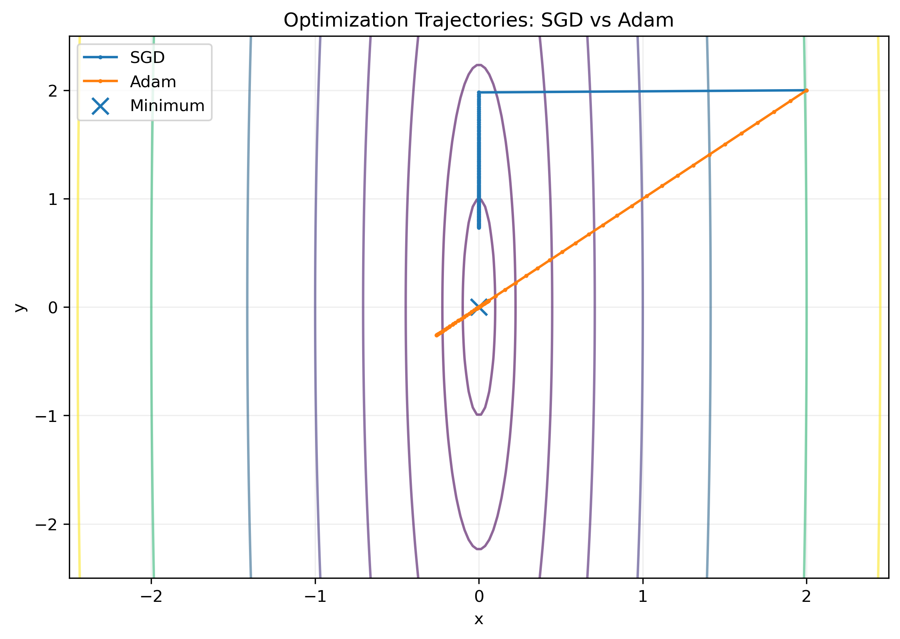
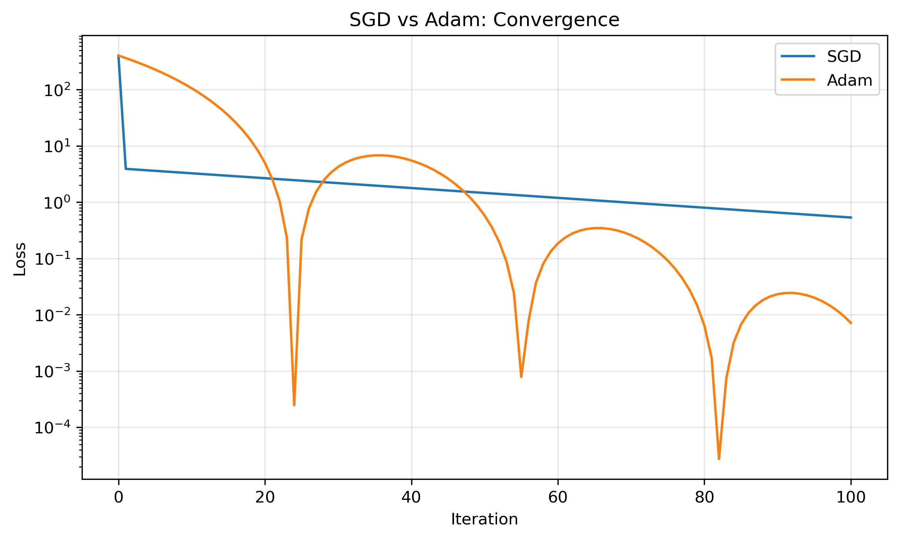

## SGD vs Adam: Optimization Experiment

We compare SGD and Adam on the quadratic loss:

f(x, y) = 100x² + y²

Both optimizers start at (2, 2), using learning rates
of 0.005 for SGD and 0.1 for Adam.

### Optimization Trajectories

### Convergence

## Training a Neural Network on MNIST

To test the implementation in a practical deep learning setting, I trained a small multilayer perceptron (MLP) on the MNIST handwritten digit dataset.

### Architecture

- **Input:** 784 features (28 × 28 grayscale images)
- **Hidden layer:** 128 neurons with ReLU activation
- **Output:** 10 classes (digits 0–9)
- **Loss:** Cross-entropy
- **Optimizer:** Custom NumPy Adam
- **Learning rate:** 0.001
- **Batch size:** 128
- **Training epochs:** 5

PyTorch handles the forward pass, loss calculation, and automatic differentiation. Gradients are extracted and passed into the custom NumPy Adam implementation, which updates the model parameters.

### Training Results

| Epoch | Training Loss | Training Accuracy |
|-------|--------------:|------------------:|
| 1     | 0.4176        | 89.01%            |
| 2     | 0.1916        | 94.48%            |
| 3     | 0.1381        | 96.02%            |
| 4     | 0.1071        | 96.89%            |
| 5     | 0.0873        | 97.47%            |

Across five epochs, training loss decreased by approximately 79%, while training accuracy improved from 89.01% to 97.47%.

These results demonstrate that the custom Adam implementation can successfully optimize the parameters of a neural network using gradients calculated by PyTorch.

*Note: Accuracy was measured on training minibatches, not the held-out MNIST test set.*

---

## Key Takeaways

Through implementing Adam from scratch and experimenting with its behavior, I explored several foundational concepts in neural network optimization:

1. **Momentum:** Adam maintains an exponential moving average of gradients to smooth noisy updates and preserve information about previous gradient directions. This can accelerate optimization but may also cause overshooting.

2. **Adaptive learning rates:** Adam tracks squared gradients to scale updates independently for each parameter. This helps when different parameters experience substantially different gradient magnitudes.

3. **Bias correction:** Since Adam initializes its moving averages at zero, early estimates are biased toward zero. Bias correction compensates for this initialization effect.

4. **SGD vs. Adam:** In the quadratic optimization experiment, SGD immediately reached the minimum along the steep direction but progressed slowly along the shallow direction. Adam normalized the gradients, allowing it to make progress along both directions while exhibiting momentum-driven oscillations.

5. **Backpropagation vs. optimization:** Backpropagation computes gradients of the loss with respect to the neural network's parameters. Adam uses those gradients to update the parameters. These are separate components of the training process.

6. **Practical neural network training:** Using my NumPy Adam implementation with PyTorch's automatic differentiation, I trained an MNIST classifier to 97.47% training accuracy in five epochs.

This project helped connect the mathematical ideas from the Adam paper to their practical role in neural network training, providing a foundation for studying deeper architectures and modern language models.
